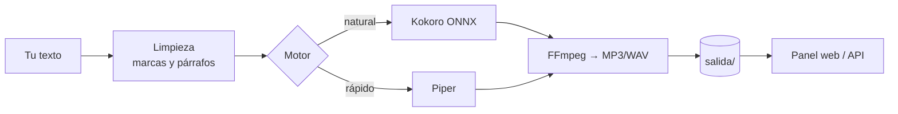

<div align="center">

# 🎙️ Voz local

**Convierte texto en voz en español en tu propio servidor, sin internet, sin cuentas y sin pagar por carácter.**

Kokoro y Piper · 3 acentos (España, México, Argentina) · 11 voces · panel web y API.

[](LICENSE)
[](requirements.txt)
[](docker-compose.yml)
[](https://keizactech.com/docs)

</div>

---

## ✨ Qué hace

- Pegas un texto de hasta **40.000 caracteres**, eliges motor, voz y velocidad, y descargas el **MP3 o WAV**.
- **Dos motores:**
  - **Kokoro**: el más natural. Unas 3 veces más rápido que el tiempo real en 2 CPUs.
  - **Piper**: el más rápido (unas 7 veces el tiempo real) y algo más plano.
- **Coste por audio: 0.** Todo corre en tu máquina.
- Limpia marcas de guion como `<break>` o `[slow]` y mete una pausa natural entre párrafos.
- Panel web adaptado al móvil, con historial, y una API para usarlo desde tus apps.

> Medido en un VPS de 2 CPUs: una narración de **9 minutos** tarda unos **3 min con Kokoro** y **1,3 min con Piper**.

## 🧠 Cómo funciona



| Archivo | Qué hace |
|---|---|
| `app/motor.py` | Los dos motores, la limpieza del texto y la unión por párrafos |
| `app/server.py` | API con FastAPI y el panel |
| `app/index.html` | Panel web (sin frameworks) |
| `descargar-modelos.sh` | Baja los modelos (~450 MB) una sola vez |

## 🚀 Arranque rápido

```bash
git clone https://github.com/RosaritoRD/voz-local.git
cd voz-local
./descargar-modelos.sh        # una sola vez, ~450 MB
docker compose up -d
```

Abre **http://localhost:8090**.

¿Quieres entrar desde el móvil? **No abras el puerto tal cual.** Ponle delante un login de Google: [docs/acceso-con-login.md](docs/acceso-con-login.md).

## 🔌 API

```bash
# Voces disponibles
curl -s http://localhost:8090/api/voces

# Generar audio
curl -s -X POST http://localhost:8090/api/generar \
  -H "Content-Type: application/json" \
  -d '{"texto":"Señor, en tus manos pongo este día.","motor":"kokoro","voz":"em_alex","velocidad":0.92,"formato":"mp3"}'
# → devuelve duración, caracteres, segundos de proceso y la url del audio

# Historial
curl -s http://localhost:8090/api/historial
```

Úsalo desde **[Oraflow](https://github.com/RosaritoRD/oraflow)** u otra app para narrar vídeos sin gastar créditos de voz.

## 🗣️ Voces

| Motor | Voz | Acento |
|---|---|---|
| Kokoro | Dora (f), Alex (m), Santa (m) | España |
| Piper | Claudio (m, alta calidad), Aldo (m) | México |
| Piper | Daniela (f, alta calidad) | Argentina |
| Piper | Dave (m), Carlos (m), Sharvard (f), Marta (f), Lucía (f) | España |

Para añadir más voces de Piper, deja el `.onnx` y su `.onnx.json` en `models/piper/`: aparecen solas en el panel.

## 🤖 Con Claude Code o Codex
Abre la carpeta con `claude` o `codex` y pídele, por ejemplo: *"Añade un motor nuevo"*, *"Haz que el panel permita subir un .txt"* o *"Conecta esta API a mi app"*.

## 💸 Ahorro y mejoras
Ver **[AHORRO-Y-MEJORAS.md](AHORRO-Y-MEJORAS.md)**.

## 📚 Más
📖 Guías y más proyectos: **[keizactech.com/docs](https://keizactech.com/docs)**

## 📄 Licencia
Código: MIT. Los modelos tienen sus propias licencias: Kokoro (Apache 2.0) y las voces de Piper (ver la ficha de cada voz en *rhasspy/piper-voices*).
