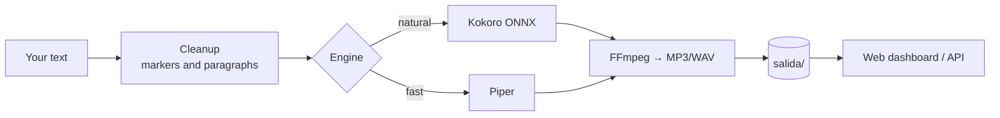

<div align="center">

# 🎙️ Local Voice

**Spanish text-to-speech on your own server — offline, no accounts, and no paying per character.**

Kokoro and Piper · 3 accents (Spain, Mexico, Argentina) · 11 voices · web dashboard and API.

[](LICENSE)
[](requirements.txt)
[](docker-compose.yml)
[](https://keizactech.com/docs)

</div>

---

## ✨ What it does

- Paste up to **40,000 characters**, pick an engine, voice and speed, and download an **MP3 or WAV**.
- **Two engines:**
  - **Kokoro**: the most natural. About 3× faster than real time on 2 CPUs.
  - **Piper**: the fastest (about 7× real time) and a bit flatter.
- **Cost per audio file: 0.** Everything runs on your machine.
- Strips script markers like `<break>` or `[slow]` and adds a natural pause between paragraphs.
- Mobile-friendly web dashboard with history, plus an API to use it from your own apps.

> Measured on a 2-CPU VPS: a **9-minute** narration takes about **3 min with Kokoro** and **1.3 min with Piper**.

## 🧠 How it works



| File | What it does |
|---|---|
| `app/motor.py` | Both engines, text cleanup and paragraph joining |
| `app/server.py` | FastAPI API and the dashboard |
| `app/index.html` | Web dashboard (no frameworks; UI in Spanish) |
| `descargar-modelos.sh` | Downloads the models (~450 MB) once |

## 🚀 Quick start

```bash
git clone https://github.com/RosaritoRD/voz-local.git
cd voz-local
./descargar-modelos.sh        # once, ~450 MB
docker compose up -d
```

Open **http://localhost:8090**.

Want to reach it from your phone? **Don't just open the port.** Put a Google login in front of it: [docs/login-access.md](docs/login-access.md).

## 🔌 API

The endpoints and fields keep their Spanish names (`voces` = voices, `generar` = generate, `texto` = text, `velocidad` = speed, `historial` = history).

```bash
# Available voices
curl -s http://localhost:8090/api/voces

# Generate audio
curl -s -X POST http://localhost:8090/api/generar \
  -H "Content-Type: application/json" \
  -d '{"texto":"Señor, en tus manos pongo este día.","motor":"kokoro","voz":"em_alex","velocidad":0.92,"formato":"mp3"}'
# → returns duration, characters, processing seconds and the audio URL

# History
curl -s http://localhost:8090/api/historial
```

Use it from **[Oraflow](https://github.com/RosaritoRD/oraflow)** or any other app to narrate videos without spending voice credits.

## 🗣️ Voices

| Engine | Voice | Accent |
|---|---|---|
| Kokoro | Dora (f), Alex (m), Santa (m) | Spain |
| Piper | Claudio (m, high quality), Aldo (m) | Mexico |
| Piper | Daniela (f, high quality) | Argentina |
| Piper | Dave (m), Carlos (m), Sharvard (f), Marta (f), Lucía (f) | Spain |

To add more Piper voices, drop the `.onnx` file and its `.onnx.json` into `models/piper/`: they show up in the dashboard automatically.

## 🤖 With Claude Code or Codex
Open the folder with `claude` or `codex` and ask, for example: *"Add a new engine"*, *"Let the dashboard accept a .txt upload"* or *"Connect this API to my app."*

## 💸 Savings and tips
See **[SAVINGS-AND-TIPS.md](SAVINGS-AND-TIPS.md)**.

## 🤝 Contributing
Issues and PRs are welcome — look for the [`good first issue`](https://github.com/RosaritoRD/voz-local/labels/good%20first%20issue) label and read [CONTRIBUTING.md](CONTRIBUTING.md). Questions, voice requests and ideas go in [Discussions](https://github.com/RosaritoRD/voz-local/discussions).

## 📚 More
📖 Guides and more projects: **[keizactech.com/docs](https://keizactech.com/docs)**

## 📄 License
Code: MIT. The models have their own licenses: Kokoro (Apache 2.0) and the Piper voices (see each voice's card in *rhasspy/piper-voices*).
